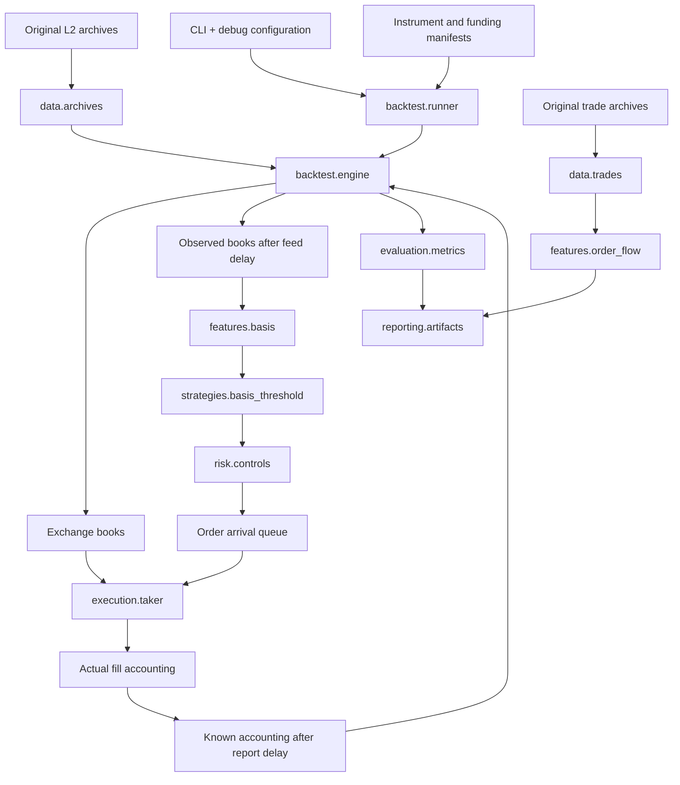

# Repository architecture

This repository implements an offline BTC spot–perpetual research pipeline for OKX. Its current runnable experiment is the two-hour V0 debug. The package is organized around nine responsibilities so the four workstreams can work against shared timing, units, and accounting rules.

**Start with the [annotated repository tree](repository_structure.txt), then follow one run below.** The [implemented specification](baseline_spec.md) defines current behavior; the [V0.1 review](baseline_review.md) describes the proposed next experiment and unresolved choices.

## 1. Source layout

```text
src/qis_spot_perp/
├── README.md                  # Navigation for contributors browsing the source
├── cli.py                     # Parse commands and dispatch
├── core/
│   └── instruments.py         # Match BTC quantity to valid spot/perpetual units
├── data/
│   ├── archives.py            # Archive calendars and streaming L2 events
│   ├── orderbook.py           # Absolute-size updates, sequence checks, stale books
│   ├── trades.py              # Trade-ID deduplication and minute notionals
│   └── manifests.py           # Download provenance and local SHA256 fingerprints
├── features/
│   ├── basis.py               # Basis, trailing-median excess, 60-second momentum
│   └── order_flow.py          # Completed-minute trade pressure and relative decay
├── strategies/
│   └── basis_threshold.py     # Pure V0 signal eligibility and rejection reasons
├── execution/
│   └── taker.py               # Consume visible depth at order arrival
├── risk/
│   └── controls.py            # Funding admission and known-account loss trigger
├── backtest/
│   ├── runner.py              # Load configuration/data, run replay, save artifacts
│   ├── engine.py              # Event queue, order lifecycle, reports, and recovery
│   └── accounting.py          # Fill cash flows, fees, funding, and inventory marks
├── evaluation/
│   ├── metrics.py             # Debug summary, drawdown, and unresolved exposure
│   └── splits.py              # Exclude labels crossing a chronological boundary
└── reporting/
    └── artifacts.py           # CSV/JSON artifacts and experiment register
```

Every package contains executable logic. Package initializers are intentionally small. The existing package name, CLI, JSON configuration, and CSV/JSON output formats remain in use.

## 2. Follow one experiment



1. `runner.run()` loads `configs/debug.json`, checks matched instrument units, and reads the funding schedule. It creates one book-event stream per leg and merges them in timestamp order.
2. `Replay` maintains separate exchange and observed books. Exchange updates are immediately eligible to affect simulated execution. A scheduled feed delay determines when an update becomes visible to the strategy.
3. At each decision, healthy observed books produce basis features. The current point is excluded from the trailing reference. Signal eligibility requires warm-up, positive basis, sufficient excess, and a reset episode. The engine also enforces the entry window and one-position lifecycle.
4. Funding admission can reject an otherwise eligible signal. Accepted signals schedule both orders; no position changes at decision time.
5. At order arrival, `sweep()` consumes the exchange book's available depth. Each actual fill updates accounting and schedules a delayed report. Known positions change only when reports arrive. The engine handles holding exits, partial-fill unwinds, and recovery timeouts.
6. Recorded trades and equity feed the summary. The writer saves tables, quality counters, configuration, and an experiment record. Trade pressure is computed separately as a diagnostic; it does not enter V0 decisions.

## 3. Interfaces and boundaries

| Producer → consumer | Interface | Meaning and constraint |
|---|---|---|
| Archives → engine | `book_events(path, leg, start, end, stats)` | Yields `(exchange_ms, leg, raw_event)`. Includes earlier snapshot history and stops before `end`; `start` does not discard reconstruction history. |
| Raw event → book | `Book.apply(event)` | Applies absolute quantities, deletes zero levels, validates sequence links when available. Converts perpetual quantities to BTC with the multiplier. |
| Observed book → features | `Features.update(t, spot_mid, perp_mid)` | Returns basis/excess/momentum in bps and warm-up readiness. No future samples. |
| Features → strategy | `entry_rejection(feature, threshold_bps, armed)` | Returns the first rejection reason or `None`. Does not send orders or change accounts. |
| Strategy → risk | `entry_crosses_funding(t, config, settlements)` | Conservative admission check including holding, order/report delays, and recovery allowance. |
| Order → execution | `sweep(book, side, quantity_btc)` | Mutates the exchange simulation book and returns `(price, BTC quantity)` fills plus unfilled BTC. Does not book fees or update the observed book. |
| Fill → account | `Account.fill(leg, side, quantity, price, fee_bps)` | Updates signed BTC inventory, USDT cash-flow identity, and per-fill fees exactly once per account. |
| Trade archive → feature | `read_trade_notionals(...)` → `pressure_rows(...)` | Separates file parsing/deduplication from pressure calculations. A minute is available only after its close; local availability would also require feed latency. |
| Replay → report | `Replay.summary()` → `summarize(engine)` | Keeps unknown funding and unresolved inventory visible; this is a debug summary, not a full performance evaluation. |

Times are Unix milliseconds. Prices and cash flows are USDT; reconstructed depth and inventory are BTC-equivalent. Decimal arithmetic is used for fills and accounting. Feature ratios use floats. CSV serialization preserves the existing string representation of Decimal values.

The engine owns the queue, episode reset, state transitions, timing, and recovery. Risk helpers evaluate policy; they do not independently mutate positions. Accounting never creates market fills. Reporting never supplies a signal. These boundaries prevent a feature change from silently changing fill or P&L rules.

## 4. Where each workstream contributes

| Workstream | Primary code | Next concrete deliverable | Handoff |
|---|---|---|---|
| A — Data | `data/`, `scripts/fetch_sample.py`, `scripts/collect_public.py` | Continuous multi-day coverage, snapshot continuity, explicit sequence and receipt-time evidence | Event streams, manifests, and quality report for C; clean observations for B |
| B — Signals | `features/`, `strategies/` | Define and test one pressure filter after V0 is auditable | Causal feature definitions and an eligibility rule using the shared engine |
| C — Backtest and validation | `backtest/`, `evaluation/`, `reporting/` | Full warm-up, chronological experiment boundaries, reconciled trade results | Reproducible run and complete result tables for all groups |
| D — Execution and risk | `core/`, `execution/`, `risk/`, shared `backtest/accounting.py` | Verify units, historical fee conventions, funding inputs, and recovery scenarios | Execution assumptions and tested cash-flow rules for C |

These are responsibility areas, not assigned GitHub usernames. Changes to event timing, contract units, or fee currencies need coordinated review because they cross workstreams. See [CONTRIBUTING](../CONTRIBUTING.md) for the review checklist.

## 5. Current implementation and next stage

| Capability | Current state | Next implementation boundary |
|---|---|---|
| Data ingestion | One dated L2 archive per leg; UTC+8 trade-file handling; bounded public collector script | Multi-day iteration and reconstruction across day boundaries |
| Features | Basis, trailing median, momentum; trade-pressure diagnostics | Add and validate OFI/liquidity features only for a specified experiment |
| Strategy | Positive-basis V0; fixed quantity and holding period | V1 pressure filter with a frozen definition and comparison protocol |
| Execution | Visible-depth IOC, feed/order/report delays, partial-fill recovery | Historical fee currencies, funding references, and margin constraints |
| Validation | Unit/integration tests, basic timestamp purge, debug metrics | Chronological development/validation/test runs, sensitivity, dependent uncertainty |
| Reporting | CSV tables, JSON quality/config/summary, experiment register, chart script | Additional report pages when the required results exist |
| Paper/maker trading | Not implemented | Separate design and validation; no empty `paper/` or maker modules in this version |

The proposed week and 24-hour lookback are still pending. Moving files does not complete those experiments. The current configuration remains one resolved JSON file: it is small enough to audit directly. Split market/strategy/execution configuration only when multiple actual experiments need composition, and retain a resolved configuration per run.

## 6. Migration from the flat package

| Previous location | Current location |
|---|---|
| `book.py`: `Book` | `data/orderbook.py` |
| `book.py`: `Book.sweep` | `execution/taker.py`: `sweep(book, ...)` |
| `book.py`: `matched_units` | `core/instruments.py` |
| `data.py`: archive functions | `data/archives.py` |
| `data.py`: trade aggregation | `data/trades.py`: `read_trade_notionals(...)`; pressure rows in `features/order_flow.py` |
| `data.py`: fingerprints and provenance | `data/manifests.py` |
| `data.py`: CSV writer | `reporting/artifacts.py` |
| `features.py` | `features/basis.py`, `features/order_flow.py`, `evaluation/splits.py` |
| `accounting.py` | `backtest/accounting.py`; funding interval policy in `risk/controls.py` |
| `replay.py` | `backtest/engine.py`; extracted strategy, execution, risk, and metrics functions |
| `cli.py`: experiment pipeline | `backtest/runner.py`; artifact persistence in `reporting/artifacts.py` |
| `tests/test_research.py` | `tests/unit/`, `tests/integration/`, shared `tests/fixtures/market.py` |

Internal Python imports change; repository scripts and tests have been updated. The command remains:

```bash
PYTHONPATH=src python3 -m qis_spot_perp.cli run --config configs/debug.json
```

New experiment source fingerprints include each Python file's relative path and contents (`relative_path_and_content_v2`). Earlier records used basenames and contents. Fingerprints will differ after the refactor; existing experiment records remain historical evidence and are not rewritten.

## 7. Verification

The refactor is checked against pre-change replay traces as well as the automated suite. See the [local refactor validation record](refactor_validation.md) for scenarios, results, and limits. Historical reports in `outputs/` retain their original provenance.
