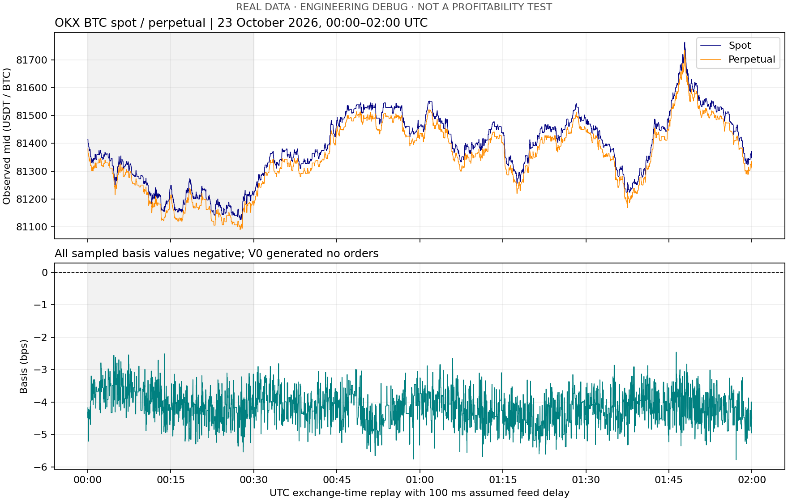

# 首轮结果 2026年10月30日

已完成真实数据下载、两小时盘口回放、零交易V0报告，以及合成成交账本和18项测试。**还没有证明策略盈利，也未完成全天/一周或样本外研究。**

## 输入和下载

已完整核对交接prompt、14页Project Guide及Reading Guide的19项索引。另核对六份论文/介绍附件的标题、版本、摘要和相关主题，并识别两份套利材料分别为两页介绍和56页论文。没有宣称全文复现所有论文。

工作区原先只有Git目录，没有覆盖既有研究代码。本轮全部实现位于当前工作区；原附件未修改。

从OKX官方公开接口取得BTC-USDT及BTC-USDT-SWAP：2026-10-23两腿400档盘口，23/24日两腿成交（UTC+8日界），当前合约规格和研究日funding历史。六个压缩文件合计606,258,642字节，约606.3 MB；全部ZIP/GZIP压缩CRC校验通过，已保存SHA256。这证明下载文件可完整解压，不证明交易所消息无遗漏。

下载清单：`data/manifests/downloads.json`；完整性：`archive_integrity.json`；附件指纹：`input_documents.json`。免费公开获取，无API密钥或采购。

## 实际处理范围和质量

原始全天文件已下载；逐条盘口重建只覆盖 **2026-10-23 00:00–02:00 UTC**。以30分钟作为明确标注的调试暖机，原计划24小时需补前一天样本。未把此调试窗口当最终测试集。

| 指标 | Spot | Perpetual |
|---|---:|---:|
| 已处理盘口消息 | 355,299 | 619,418 |
| 快照数 | 8 | 8 |
| 缺失序列字段的消息 | 355,299 | 619,418 |
| 时间倒退 | 0 | 0 |
| 目标两小时成交记录 | 35,678 | 227,138 |
| 重复成交ID | 0 | 0 |
| source=1成交 | 251 | 635 |

档案只有action和毫秒ts，没有seqId/prevSeqId及本机接收时间。因此允许受限exchange-time研究，**序列连续性未验证**。每秒决策共7199个有效观测；开头一次决策尚无行情被拒绝。没有插值或未来nearest匹配。未来完整性评估仍需实时序列/供应商证据。

## V0为何没有开仓

在有效的每秒观测中，basis最小−5.7822 bps，中位数−4.1477 bps，最大−2.4632 bps。永续在这个窗口始终相对现货便宜；V0只允许正溢价方向，所以允许入场期间2999次决策均被正basis条件拒绝。



结果：orders=0、fills=0、closed trades=0、结束库存=0。已生成带字段表头的空交易表，而不是伪造一笔交易。毛收益、费用、funding和净现金流均为0，是**未交易**的账户恒等结果；胜率和最差交易为空，不解释成零风险或成本已通过验证。

费率使用现货10 bps/次、永续5 bps/次的教学情景；feed/order/report分别假设100/150/100 ms。由于无真实样本订单，不能从本轮估计其经济影响。实际账户费率、历史规则、保证金清算尚未验证。funding参考价格缺失，计划跨结算点的交易会被阻止；不能把缺失现金流当0。

## 已验证的程序行为

18项测试覆盖：教学毛利润+2、相同美元涨幅抵消、绝对数量覆盖和0删除、缺序列拒绝、心跳/重复/重置、100006的VWAP、深度不足部分成交、静态市场跨价与费用损失、funding正负及实际数量、UTC/UTC+8边界、同timestamp不同trade_id、未来数据不改过去特征、暖机缺口、按时间purge、contract multiplier、订单到达时报价、回报延迟、部分成交撤回、未平仓结尾。

`outputs/synthetic_demo`另有完整模拟订单/成交/交易表：人为价格与两秒持有期下产生一笔交易，gross −0.02 USDT，fees 3.003015 USDT，net −3.023015 USDT。这里只检查账本和状态机；不是历史回测，不应与真实零交易结果合并。

第一次与最终回放均登记在`outputs/experiment_register.jsonl`；两次结果一致，后一版补充质量指标与Decimal单位转换。每次记录运行命令、参数、Python和源码指纹；所有尝试保留。

## 可复现命令

```bash
PYTHONPATH=src python3 -m unittest discover -s tests -v
PYTHONPATH=src python3 scripts/synthetic_demo.py
PYTHONPATH=src python3 -m qis_spot_perp.cli run --config configs/debug.json
```

核心无第三方依赖，本轮Python3.14.2。下载/清单/压缩完整性/绘图命令见README。实时采集脚本已准备，有时长和字节上限，但本轮未联网运行；不把接口实现称为真实采集验证。

## 下一项最有价值的实验

预先固定连续日期范围，加入24小时暖机，再统计是否有足够多的正溢价episode。若整周都缺少适合该方向的事件，报告该方向在该时期缺乏机会，而不是删掉正basis条件或只挑盈利日。

在有真实交易后，优先核对每次成交、历史费用/币种、funding参考价和保证金路径，再比较压力与momentum的单独增量。不对两小时样本给Sharpe或置信区间，不把合成正确性当作可执行收益证据。
